<!--
  ╔══════════════════════════════════════════════════════════════════════════════╗
  ║         ⚔️  THE ARCHITECT OF POSSIBILITIES — PARTHA-ZZZ  ⚔️                 ║
  ║                 나 혼자만 레벨업 — I ALONE LEVEL UP                          ║
  ╚══════════════════════════════════════════════════════════════════════════════╝
-->

<!-- ══════ TOP STATUS BAR ══════ -->
<p align="center">
  
  &nbsp;
  
  &nbsp;
  
  &nbsp;
  
  &nbsp;
  
</p>

<!-- ══════ CINEMATIC HEADER BANNER (Animated SVG with Moon & Dungeon Gate) ══════ -->
<p align="center">
  
</p>

<!-- ══════ TYPING ANIMATION (Solo Leveling & Architect Lore) ══════ -->
<p align="center">
  
</p>

<br/>

<!-- ══════ THE AWAKENING: ARCHITECT HERO SHOWCASE ══════ -->
## ⚔️ `[ THE ARCHITECT'S AWAKENING ]`

<table>
  <tr>
    <td width="40%" align="center" valign="middle">
      
      <br/>
      <sub><b>Partha Sarathi Sarkar (파르타) — The Architect</b></sub>
    </td>
    <td width="60%" valign="top">
      <div align="center">
        
      </div>
      <br/>

```python
class TheArchitect:
    """The Developer Who Reconstructs Possibility Through AI & Data."""
    hunter_name = "Partha Sarathi Sarkar"
    alias       = "Partha-zzz"
    rank        = "Awakened S-Class"
    class_type  = "CSE (AI & ML) Undergrad & Aspiring Data Scientist"
    mana_pool   = "Unlimited (Curiosity, AI Workflows & Clean Code)"
    origin      = "Haldia, West Bengal, India"
    
    awakened_runes = [
        "Data Science & Analytics", "Machine Learning Architecture",
        "Pythonic Scripting", "AI-Assisted Full-Stack Prototyping",
        "Japanese Linguistics (JLPT N5 Completed -> N4 Prep)"
    ]
    
    shadow_army = ["Python", "Pandas", "Matplotlib", "Next.js", "Supabase", "Git"]
    
    def command(self):
        return "ARISE. (일어나라) — The possibilities are limitless."
```

    </td>
  </tr>
</table>

<br/>

---

<!-- ══════ CINEMATIC GALLERY: ARCHITECT VISUAL ARCHIVES ══════ -->
## 🔮 `[ THE SHADOW DOMAIN — VISUAL ARCHIVES ]`

<p align="center"><i>"A curious technology enthusiast exploring cultures, designing systems, and unlocking limitless possibilities through technology."</i></p>

<table align="center" width="100%">
  <tr>
    <td width="33%" align="center" valign="top">
      <h4>⚡ Perception (감각)</h4>
      
      <br/><br/>
      <sub><b>Architect's Vision:</b> Detecting underlying data patterns, mathematical distributions & neural representations.</sub>
    </td>
    <td width="34%" align="center" valign="top">
      <h4>👑 Shadow Extraction (그림자 추출)</h4>
      
      <br/><br/>
      <sub><b>The Arise Command:</b> Summoning advanced AI coding agents (Antigravity, Claude, Stitch) as co-pilots to rapidly architect software.</sub>
    </td>
    <td width="33%" align="center" valign="top">
      <h4>🗡️ System Architecture (건축술)</h4>
      
      <br/><br/>
      <sub><b>Precision Execution:</b> Crafting clean pipelines, data-driven backends, and responsive interactive web experiences.</sub>
    </td>
  </tr>
</table>

<br/>

<!-- Cultural & Linguistic Horizon -->
<div align="center">

| Language Discipline | Fluency Tier | Cultural Horizon | Mastery Status |
|:--------------------|:------------:|:-----------------|:--------------:|
| 🇬🇧 **English** | Professional / Academic | Technical documentation, global engineering discourse | **ACTIVE** |
| 🇮🇳 **Bengali (বাংলা)** | Native Heritage | Cultural philosophy, literature, native fluency | **NATIVE** |
| 🇮🇳 **Hindi (हिन्दी)** | Multilingual Fluent | National collaboration, media, versatile conversation | **FLUENT** |
| 🇯🇵 **Japanese (日本語)** | JLPT N5 Certified 🏆 | Kanji, grammatical subtleties, cultural exploration | **PREPARING N4 ⚡** |

</div>

<br/>

---

<!-- ══════ PRIMARY SOUL WEAPON: PYTHON & DATA SCIENCE ══════ -->
## 🐍 `[ PRIMARY SOUL WEAPON — PYTHON & DATA SCIENCE REACTOR ]`

<p align="center">
  <i>"In a world where algorithms govern complexity, Python is the foundation of every model."</i>
</p>

<!-- Custom Animated Python Core Sci-Fi HUD -->
<p align="center">
  
</p>

<div align="center">

| Core Component | Specialization Domain | Focus Area & Capabilities | Resonance Rank |
|:---------------|:---------------------:|:--------------------------|:--------------:|
| 🐍 **Python 3** | Scripting & Algorithmic Core | Object-oriented design, workflow automation & data manipulation | ⚡ **PRIMARY CORE** |
| 🐼 **Pandas** | High-Dimensional Matrix | DataFrame operations, data cleaning, aggregation & feature engineering | 📊 **VECTOR MASTER** |
| 📈 **Matplotlib** | Perceptual Analytics | Quantitative visualizations, distribution curves & scientific insights | 👁️ **VISUAL OPTICS** |
| 📓 **Jupyter Notebook** | Experimental Sandbox | Exploratory Data Analysis (EDA), model experimentation & iterative research | 🔬 **RESEARCH LAB** |
| 🤖 **AI Co-Pilots** | Agentic Development | Antigravity, Claude, Stitch, Codex — rapid prototyping co-pilots | 🌌 **ACCELERATOR** |

</div>

<br/>

---

<!-- ══════ HUNTER ATTRIBUTE MATRIX ══════ -->
## 📜 `[ HUNTER ATTRIBUTE MATRIX — S-RANK ARCHITECT ]`

<div align="center">

| Attribute | Level / Value | Assigned Domain & Capability | Combat Rating |
|:----------|:-------------:|:-----------------------------|:-------------:|
| **INT (Architectural Intellect)** | `99 / 100` | CSE (AI & ML) foundation, mathematical intuition, model evaluation | `S-TIER MAX` |
| **CREA (Creation & Innovation)** | `98 / 100` | Designing novel applications from blank canvases into tangible software | `S-TIER` |
| **AI (Agentic Symbiosis)** | `99 / 100` | Orchestrating state-of-the-art AI coding tools to accelerate production | `S-TIER MAX` |
| **DATA (Quantitative Perception)** | `96 / 100` | Uncovering insights across structured datasets via Pandas & Matplotlib | `S-TIER` |
| **DEV (Full-Stack Building)** | `94 / 100` | Crafting modern Next.js, Tailwind, Supabase apps via assisted workflows | `A-TIER ELITE` |
| **LANG (Cultural Horizon)** | `95 / 100` | Multilingual versatility & active progression toward Japanese JLPT N4 | `S-TIER` |

</div>

<br/>

---

<!-- ══════ SCI-FI TECH STACK: THE SHADOW ARSENAL ══════ -->
## 💀 `[ THE SHADOW ARMY ARSENAL — RUNES & SKILLS ]`

<p align="center"><i>Each technology is an awakened soldier bound to my engineering command</i></p>

### 👑 S-Class Primary Soul Weapon (Data Science & Core Programming)
<p align="center">
  
  &nbsp;
  
  &nbsp;
  
  &nbsp;
  
</p>

### 🤖 AI-Assisted Development & Agentic Co-Pilots
<p align="center">
  
  &nbsp;
  
  &nbsp;
  
  &nbsp;
  
  &nbsp;
  
</p>

### 🌐 Illusion Spellcraft (Modern Frontend & Reactive Frameworks)
<p align="center">
  
</p>

### 🏰 Storage Vaults & Deployment Infrastructure
<p align="center">
  
  &nbsp;
  
  &nbsp;
  
</p>

### 🛡️ Hunter Toolchain & CLI Media Utilities
<p align="center">
  
  &nbsp;
  
  &nbsp;
  
</p>

> ℹ️ **Transparency Note**: AI-assisted development is leveraged as an engineering workflow to co-author, prototype, and build comprehensive web applications and tools. Core independent technical proficiency centers on Python, Data Science analytics, and Machine Learning.

<br/>

---

<!-- ══════ THE MONARCH'S PROJECT ARCHIVES ══════ -->
## 🏆 `[ THE MONARCH'S CONQUERED DUNGEONS — PROJECT ARCHIVES ]`

<div align="center">

| Project Vault | Description & Architecture | Weapons / Tech Stack | Access Gate |
|:--------------|:---------------------------|:---------------------|:-----------:|
| 🌌 **NASA Space Apps: Forgotten Legacy** | Immersive cosmos web application commemorating unsung aerospace pioneers through interactive 3D visualizations. | `Next.js` • `Three.js` • `Tailwind CSS` | [🚀 **LIVE PORTAL**](https://nasa-forgotten-legacy.vercel.app/) |
| 🛡️ **ExploitReplay** | Automated cybersecurity vulnerability reproduction framework executing sandboxed exploit verification. | `Python` • `Security Research` • `Automation` | [⚔️ **SOURCE CODE**](https://github.com/Partha-zzz/ExploitReplay) |
| 🚑 **ResQAI (Disaster Management)** | AI-driven emergency response orchestration system providing automated triage coordination and route optimization. | `Next.js` • `AI Workflows` • `Supabase` | [🌐 **LIVE PORTAL**](https://res-q-ai-blond.vercel.app/) |

</div>

<br/>

---

<!-- ══════ MONARCH POWER LEVEL & COMBAT RECORDS ══════ -->
## 📊 `[ MONARCH POWER LEVEL & COMBAT RECORDS ]`

<p align="center">
  
  &nbsp;
  
</p>

<p align="center">
  
</p>

<br/>

---

<!-- ══════ SHADOW SERPENT (SNAKE CONTRIBUTION ANIMATION) ══════ -->
## 🐍 `[ SHADOW SERPENT DEVOURING COMMITS ]`

<p align="center">
  <picture>
    <source media="(prefers-color-scheme: dark)"
      srcset="https://raw.githubusercontent.com/Partha-zzz/Partha-zzz/output/github-snake-dark.svg"/>
    <source media="(prefers-color-scheme: light)"
      srcset="https://raw.githubusercontent.com/Partha-zzz/Partha-zzz/output/github-snake.svg"/>
    
  </picture>
</p>

<p align="center">
  <sub>⚔️ <i>Powered by GitHub Actions — tracking every contribution conquered on GitHub.</i></sub>
</p>

<br/>

---

<!-- ══════ ACTIVE DUNGEON QUESTS ══════ -->
## 🗡️ `[ ACTIVE DUNGEON QUEST LOG ]`

<div align="center">

| Dungeon Quest | Rank | Status | EXP Reward |
|:--------------|:----:|:------:|-----------:|
| **Computer Science & Engineering (AI & ML) Degree** | `S-Rank Main` | `⚔️ IN PROGRESS` | `+10,000 XP` |
| **Advanced Data Science & Machine Learning Mastery** | `S-Rank Main` | `⚔️ IN PROGRESS` | `+5,000 XP` |
| **Japanese JLPT N4 Language Awakening** (Kanji & Grammar) | `A-Rank Quest` | `📖 ACTIVE STUDY` | `+2,500 XP` |
| **Autonomous AI Agent Orchestration & Application Building** | `S-Rank Raid` | `⚔️ IN PROGRESS` | `+4,000 XP` |
| **Daily Algorithm, Exploration & Open Source Raids** | `Daily Quest` | `🔄 NEVER ENDING` | `+∞ XP` |

</div>

<br/>

---

<!-- ══════ GUILD SUMMONING PORTAL (CONNECT) ══════ -->
## 🌐 `[ OPEN A DUNGEON GATE — SUMMON THE ARCHITECT ]`

<p align="center"><i>Ready to form a party, collaborate on innovative projects, or discuss AI and data science?</i></p>

<p align="center">
  <a href="https://www.linkedin.com/in/partha-sarathi-sarkar-7385a8367" target="_blank">
    
  </a>
  &nbsp;
  <a href="https://www.instagram.com/uza_bhaiya/" target="_blank">
    
  </a>
  &nbsp;
  <a href="https://github.com/Partha-zzz" target="_blank">
    
  </a>
</p>

<br/>

<!-- ══════ FOOTER — MARCHING SHADOW ARMY ══════ -->
<p align="center">
  
</p>

<p align="center">
  
</p>
