<!--
  ╔══════════════════════════════════════════════════════════════════════════════╗
  ║         ⚔️  THE ARCHITECT OF POSSIBILITIES — PARTHA-ZZZ  ⚔️                 ║
  ║                 나 혼자만 레벨업 — I ALONE LEVEL UP                          ║
  ╚══════════════════════════════════════════════════════════════════════════════╝
-->

<!-- ══════ TOP STATUS BAR ══════ -->

  
  &nbsp;
  
  &nbsp;
  
  &nbsp;
  
  &nbsp;
  

<!-- ══════ CINEMATIC HEADER BANNER (Animated SVG with Moon & Dungeon Gate) ══════ -->

  

<!-- ══════ TYPING ANIMATION (Solo Leveling & Architect Lore) ══════ -->

  

 

<!-- ══════ THE AWAKENING: ARCHITECT HERO SHOWCASE ══════ -->
## ⚔️ `[ THE ARCHITECT'S AWAKENING ]`

<table align="center" width="100%">
  <tr>
    <td width="38%" align="center" valign="middle">
      
        
      <b>Partha Sarathi Sarkar (파르타) — The Architect</b>
    </td>
    <td width="62%" align="center" valign="middle">
      
    </td>
  </tr>
</table>

 

---

<!-- ══════ CINEMATIC GALLERY: ARCHITECT VISUAL ARCHIVES ══════ -->
## 🔮 `[ THE SHADOW DOMAIN — VISUAL ARCHIVES ]`

<i>"A curious technology enthusiast exploring cultures, designing systems, and unlocking limitless possibilities through technology."</i>

<table align="center" width="100%">
  <tr>
    <td width="33%" align="center" valign="top">
      <h4>⚡ Perception (감각)</h4>
      
        
      <b>Architect's Vision:</b> Detecting underlying data patterns, mathematical distributions & neural representations.
    </td>
    <td width="34%" align="center" valign="top">
      <h4>👑 Shadow Extraction (그림자 추출)</h4>
      
        
      <b>The Arise Command:</b> Summoning advanced AI coding agents (Antigravity, Claude, Stitch) as co-pilots to rapidly architect software.
    </td>
    <td width="33%" align="center" valign="top">
      <h4>🗡️ System Architecture (건축술)</h4>
      
        
      <b>Precision Execution:</b> Crafting clean pipelines, data-driven backends, and responsive interactive web experiences.
    </td>
  </tr>
</table>

 

<!-- Cultural & Linguistic Horizon -->

| Language Discipline | Fluency Tier | Cultural Horizon | Mastery Status |
|:--------------------|:------------:|:-----------------|:--------------:|
| 🇬🇧 **English** | Professional / Academic | Technical documentation, global engineering discourse | **ACTIVE** |
| 🇮🇳 **Bengali (বাংলা)** | Native Heritage | Cultural philosophy, literature, native fluency | **NATIVE** |
| 🇮🇳 **Hindi (हिन्दी)** | Multilingual Fluent | National collaboration, media, versatile conversation | **FLUENT** |
| 🇯🇵 **Japanese (日本語)** | JLPT N5 Certified 🏆 | Kanji, grammatical subtleties, cultural exploration | **PREPARING N4 ⚡** |

 

---

<!-- ══════ PRIMARY SOUL WEAPON: PYTHON & DATA SCIENCE ══════ -->
## 🐍 `[ PRIMARY SOUL WEAPON — PYTHON & DATA SCIENCE REACTOR ]`

  <i>"In a world where algorithms govern complexity, Python is the foundation of every model."</i>

<!-- Custom Animated Python Core Sci-Fi HUD -->

  

 

---

<!-- ══════ HUNTER ATTRIBUTE MATRIX ══════ -->
## 📜 `[ HUNTER ATTRIBUTE MATRIX — S-RANK ARCHITECT ]`

<!-- Custom Holographic Attribute Dashboard -->

  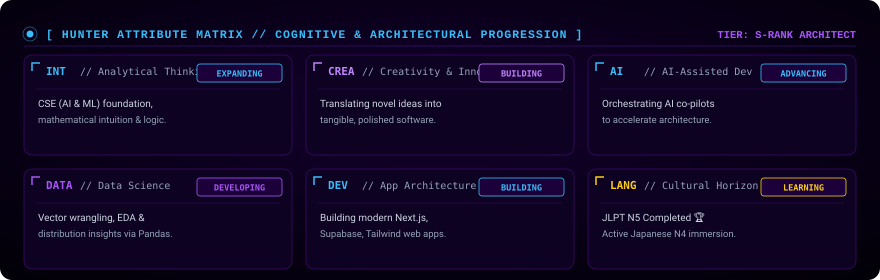

 

---

<!-- ══════ SCI-FI TECH STACK: THE SHADOW ARSENAL ══════ -->
## 💀 `[ THE SHADOW ARMY ARSENAL — RUNES & SKILLS ]`

<i>Each technology is an awakened soldier bound to my engineering command</i>

<!-- Custom Themed Technology Armory Container -->

  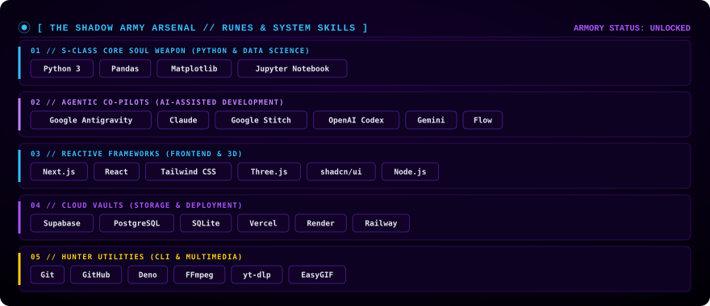

> ℹ️ **Transparency Note**: AI-assisted development is leveraged as an engineering workflow to co-author, prototype, and build comprehensive web applications and tools. Core independent technical proficiency centers on Python, Data Science analytics, and Machine Learning.

 

---

<!-- ══════ THE MONARCH'S PROJECT ARCHIVES ══════ -->
## 🏆 `[ THE MONARCH'S CONQUERED DUNGEONS — PROJECT ARCHIVES ]`

<!-- Project 01: NASA Space Apps -->

  <a href="https://nasa-forgotten-legacy.vercel.app/" target="_blank">
    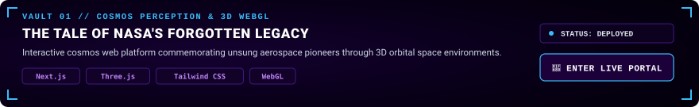
  </a>

<!-- Project 02: ExploitReplay -->

  <a href="https://github.com/Partha-zzz/ExploitReplay" target="_blank">
    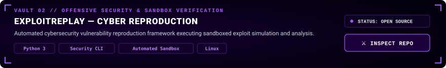
  </a>

<!-- Project 03: ResQAI -->

  <a href="https://res-q-ai-blond.vercel.app/" target="_blank">
    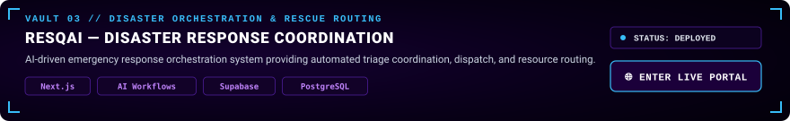
  </a>

 

---

<!-- ══════ MONARCH POWER LEVEL & COMBAT RECORDS ══════ -->
## 📊 `[ MONARCH POWER LEVEL & COMBAT RECORDS ]`

<!-- Verified Custom GitHub Telemetry HUD -->

  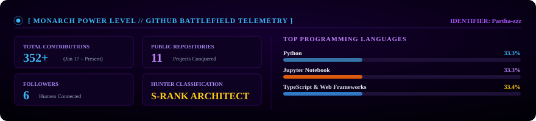

<!-- Verified Live Streak Stats -->

  

 

---

<!-- ══════ SHADOW SERPENT (SNAKE CONTRIBUTION ANIMATION) ══════ -->
## 🐍 `[ SHADOW SERPENT DEVOURING COMMITS ]`

  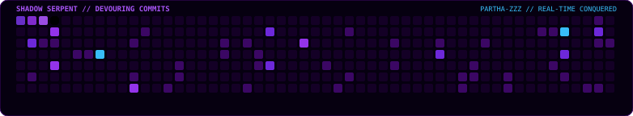

  ⚔️ <i>Powered by automated contribution tracking — devouring every conquered node on GitHub.</i>

 

---

<!-- ══════ ACTIVE DUNGEON QUESTS ══════ -->
## 🗡️ `[ ACTIVE DUNGEON QUEST LOG ]`

<!-- Custom Holographic Quest Registry Dashboard -->

  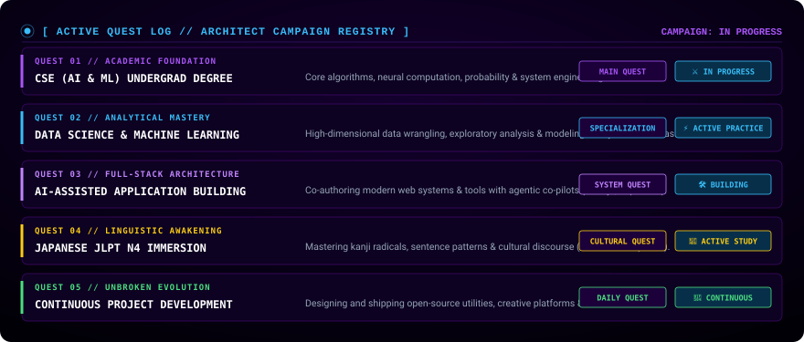

 

---

<!-- ══════ GUILD SUMMONING PORTAL (CONNECT) ══════ -->
## 🌐 `[ OPEN A DUNGEON GATE — SUMMON THE ARCHITECT ]`

<i>Ready to form a party, collaborate on innovative projects, or discuss AI and data science?</i>

  
  &nbsp;
  
  &nbsp;
  

 

<!-- ══════ FOOTER — MARCHING SHADOW ARMY ══════ -->

  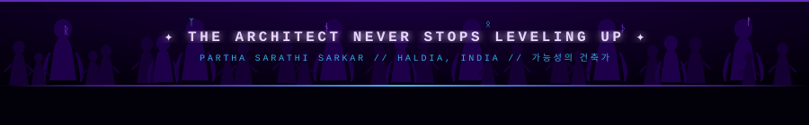

  

