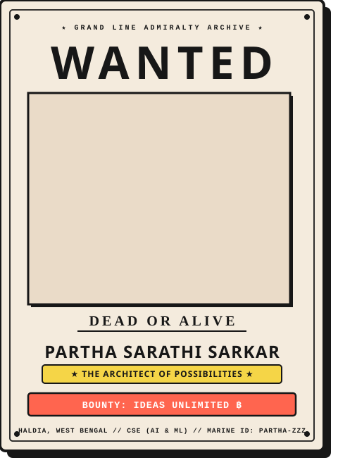
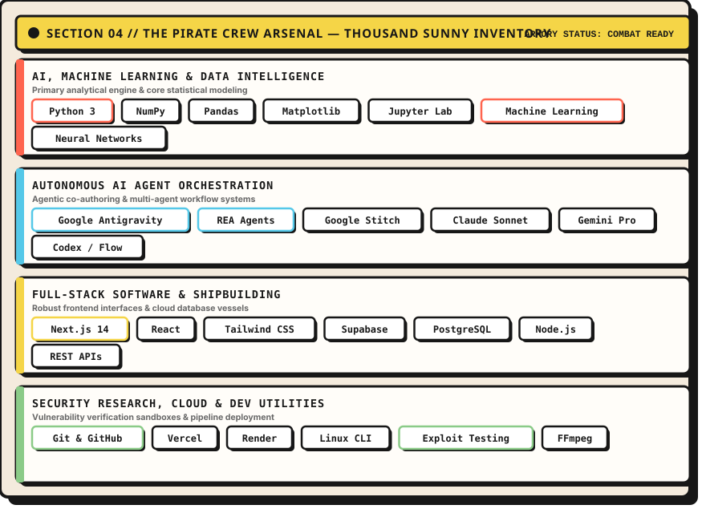
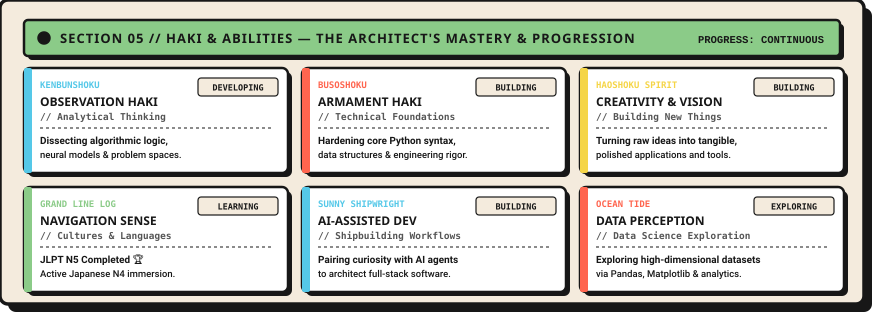
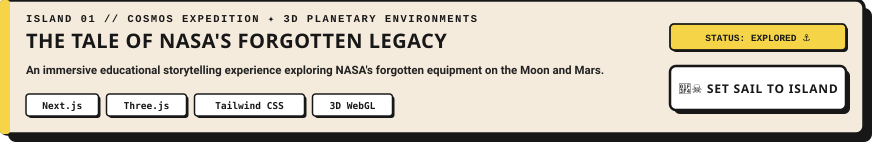
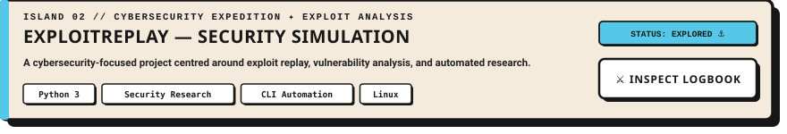
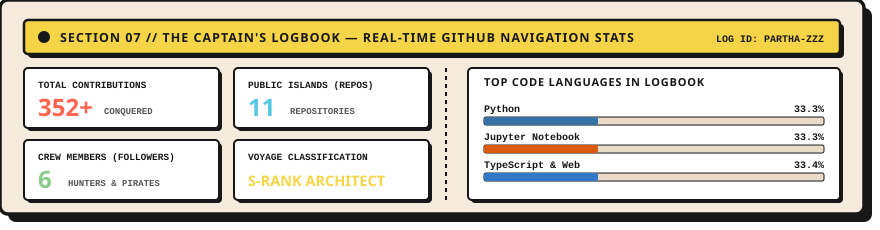
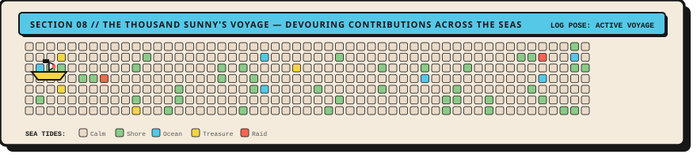
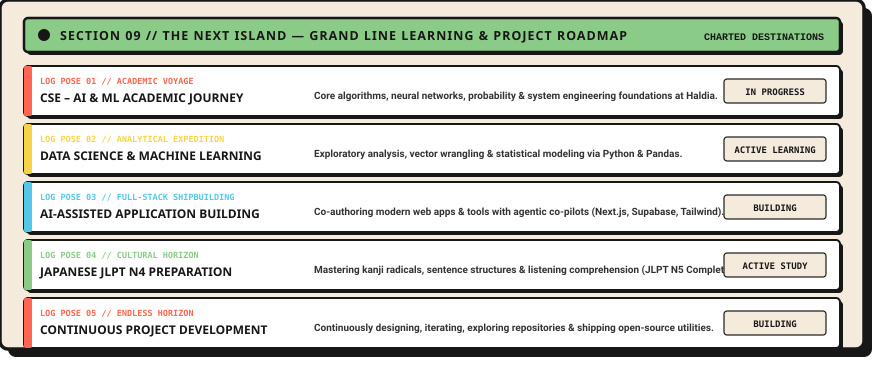
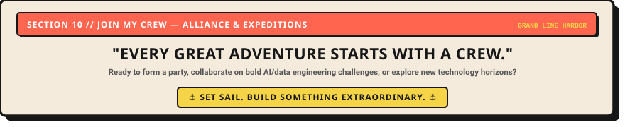

<!--
  ╔══════════════════════════════════════════════════════════════════════════════╗
  ║         ☠️  THE GRAND LINE OF TECHNOLOGY — PARTHA-ZZZ  ☠️                   ║
  ║       THE ARCHITECT OF POSSIBILITIES // ONE PIECE × NEO-BRUTALISM            ║
  ╚══════════════════════════════════════════════════════════════════════════════╝
-->

<!-- ══════ TOP STATUS BAR (NEO-BRUTALIST VIBRANT RIBBON) ══════ -->

  
  &nbsp;
  
  &nbsp;
  
  &nbsp;
  
  &nbsp;
  

<!-- ══════ CINEMATIC HEADER BANNER (THE GRAND LINE OF TECHNOLOGY) ══════ -->

  

<!-- ══════ TYPING ANIMATION (ONE PIECE LOG POSE ANNOTATIONS) ══════ -->

  

 

<!-- ══════ SECTION 01 — THE CAPTAIN'S INTRODUCTION (WANTED POSTER) ══════ -->
## 🏴‍☠️ `[ SECTION 01 // THE CAPTAIN'S INTRODUCTION — WANTED POSTER ]`

  <i>"THE NEXT ISLAND IS ALWAYS WAITING."</i>

  

 

---

<!-- ══════ SECTION 02 — THE MAN BEHIND THE STRAW HAT ══════ -->
## 🧭 `[ SECTION 02 // THE MAN BEHIND THE STRAW HAT — CAPTAIN'S LOGBOOK ]`

  

 

---

<!-- ══════ SECTION 03 — THE DEVIL FRUIT POWERS ══════ -->
## 🍈 `[ SECTION 03 // DEVIL FRUIT POWERS — THE DATA-DATA FRUIT ]`

  

 

---

<!-- ══════ SECTION 04 — THE PIRATE CREW ARSENAL ══════ -->
## ⚓ `[ SECTION 04 // THE PIRATE CREW ARSENAL — THOUSAND SUNNY INVENTORY ]`

  

 

---

<!-- ══════ SECTION 05 — HAKI & ABILITIES ══════ -->
## ⚡ `[ SECTION 05 // HAKI & ABILITIES — THE ARCHITECT'S PROGRESSION ]`

  

 

---

<!-- ══════ SECTION 06 — GRAND LINE ADVENTURES (PROJECT SHOWCASE) ══════ -->
## 🏝️ `[ SECTION 06 // GRAND LINE ADVENTURES — CONQUERED ISLANDS ]`

<!-- Island 01: NASA Space Apps -->

  

<!-- Island 02: ExploitReplay -->

  

<!-- Island 03: ResQAI -->

  

 

---

<!-- ══════ SECTION 07 — THE CAPTAIN'S LOGBOOK (GITHUB STATISTICS) ══════ -->
## 📜 `[ SECTION 07 // THE CAPTAIN'S LOGBOOK — NAVIGATION TELEMETRY ]`

  

 

---

<!-- ══════ SECTION 08 — THE THOUSAND SUNNY'S VOYAGE (SNAKE CONTRIBUTION) ══════ -->
## ⛵ `[ SECTION 08 // THE THOUSAND SUNNY'S VOYAGE — DEVOURING CONTRIBUTIONS ]`

  

  🏴‍☠️ <i>Tracking every contribution conquered on GitHub — sailing across the Grand Line of Code.</i>

 

---

<!-- ══════ SECTION 09 — THE NEXT ISLAND (GRAND LINE ROADMAP) ══════ -->
## 🗺️ `[ SECTION 09 // THE NEXT ISLAND — GRAND LINE ROADMAP ]`

  

 

---

<!-- ══════ SECTION 10 — JOIN MY CREW (CONTACT & RECRUITMENT) ══════ -->
## 🤝 `[ SECTION 10 // JOIN MY CREW — ALLIANCE & EXPEDITIONS ]`

  

  
  &nbsp;
  
  &nbsp;
  

 

  

