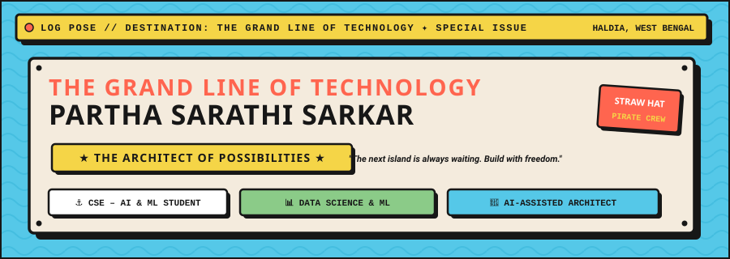
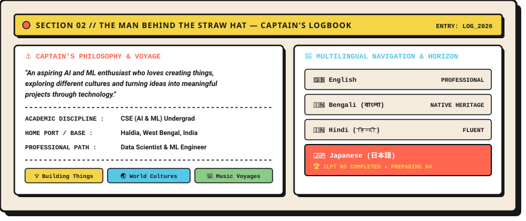
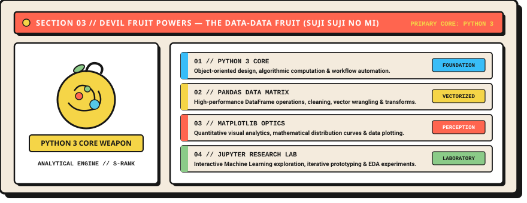
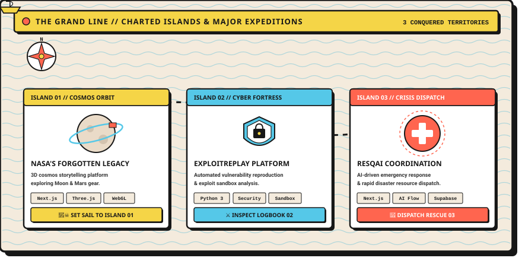
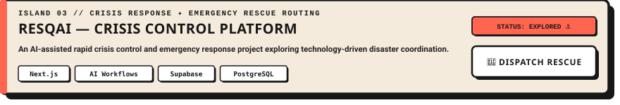

<!--
  ╔══════════════════════════════════════════════════════════════════════════════╗
  ║         ☠️  THE GRAND LINE OF TECHNOLOGY — PARTHA-ZZZ  ☠️                   ║
  ║       THE ARCHITECT OF POSSIBILITIES // ONE PIECE × NEO-BRUTALISM            ║
  ╚══════════════════════════════════════════════════════════════════════════════╝
-->

<!-- ══════ TOP STATUS BAR (NEO-BRUTALIST VIBRANT RIBBON) ══════ -->

  
  &nbsp;
  
  &nbsp;
  
  &nbsp;
  
  &nbsp;
  

<!-- ══════ CINEMATIC HEADER BANNER (THE GRAND LINE OF TECHNOLOGY) ══════ -->

  

<!-- ══════ INTERACTIVE ANCHOR LOG POSE NAVIGATION ══════ -->

  <a href="#the-captains-wanted-poster"><b>[ 📜 WANTED POSTER ]</b></a> &bull;
  <a href="#the-captains-logbook"><b>[ 🧭 CAPTAIN'S LOG ]</b></a> &bull;
  <a href="#devil-fruit-powers"><b>[ 🍈 DEVIL FRUIT ]</b></a> &bull;
  <a href="#thousand-sunny-arsenal"><b>[ ⚓ ARSENAL ]</b></a> &bull;
  <a href="#grand-line-expeditions"><b>[ 🏝️ EXPEDITIONS ]</b></a> &bull;
  <a href="#thousand-sunny-voyage"><b>[ ⛵ SUNNY VOYAGE ]</b></a> &bull;
  <a href="#join-the-crew"><b>[ 🤝 ALLIANCE ]</b></a>

<!-- ══════ TYPING ANIMATION (ONE PIECE LOG POSE ANNOTATIONS) ══════ -->

  

 

<!-- ══════ SECTION 01 — THE HERO SPLIT (LUFFY GEAR 5 × WANTED POSTER) ══════ -->

## 🏴‍☠️ `[ SECTION 01 // THE CAPTAIN'S INTRODUCTION — WANTED POSTER ]`

<table border="0" cellspacing="0" cellpadding="12" style="border-collapse: collapse; margin: 0 auto; text-align: center;">
  <tr valign="middle">
    <td width="45%" align="center" style="background-color: #F4EBDD; border: 3.5px solid #171717; box-shadow: 8px 8px 0px #171717; padding: 18px;">
      

        ⚡ AWAKENED GEAR 5 — FREEDOM TO BUILD ⚡
      

      
      

        <i>"I've never felt so free! Let's turn every impossible idea into working software!"</i> 
        <b>— CAPTAIN PARTHA SARATHI SARKAR</b>
      

    </td>
    <td width="55%" align="center" style="padding-left: 20px;">
      
    </td>
  </tr>
</table>

 

---

<!-- ══════ SECTION 02 — THE CAPTAIN'S LOGBOOK & STRAW HAT DIMENSIONS ══════ -->

## 🧭 `[ SECTION 02 // THE MAN BEHIND THE STRAW HAT — CAPTAIN'S LOGBOOK ]`

  

<!-- 3-Column Character Passions Showcase (Luffy, Chopper, Brook) -->

<table border="0" cellspacing="0" cellpadding="8" style="border-collapse: collapse; width: 100%; max-width: 880px; margin: 15px auto;">
  <tr valign="top">
    <td width="33%" align="center" style="background-color: #F4EBDD; border: 3px solid #171717; box-shadow: 6px 6px 0px #171717; padding: 12px;">
      

        PASSION 01 // CREATION
      

      
      <h4 style="margin: 8px 0 4px; color: #171717; font-family: monospace;">BUILDING & PROTOTYPING</h4>
      

        Turning wild ideas into tangible applications using autonomous AI copilots and full-stack velocity.
      

    </td>
    <td width="33%" align="center" style="background-color: #F4EBDD; border: 3px solid #171717; box-shadow: 6px 6px 0px #171717; padding: 12px;">
      

        PASSION 02 // CULTURES
      

      
      <h4 style="margin: 8px 0 4px; color: #171717; font-family: monospace;">JAPANESE & GLOBAL LORE</h4>
      

        <b>JLPT N5 Cleared 🏆</b> &bull; Now conquering <b>JLPT N4</b>. Fascinated by Kanji, linguistics, and cultural horizons.
      

    </td>
    <td width="33%" align="center" style="background-color: #F4EBDD; border: 3px solid #171717; box-shadow: 6px 6px 0px #171717; padding: 12px;">
      

        PASSION 03 // VIBES
      

      
      <h4 style="margin: 8px 0 4px; color: #171717; font-family: monospace;">MUSIC & SOUL DISCOVERY</h4>
      

        Bink's Sake on loop. Exploring eclectic musical genres, anime OSTs, and acoustic soundscapes while coding.
      

    </td>
  </tr>
</table>

 

---

<!-- ══════ SECTION 03 — THE DEVIL FRUIT POWERS ══════ -->

## 🍈 `[ SECTION 03 // DEVIL FRUIT POWERS — THE DATA-DATA FRUIT ]`

  

 

---

<!-- ══════ SECTION 04 — THE PIRATE CREW ARSENAL (FEAT. THREE-SWORD STYLE ZORO) ══════ -->

## ⚓ `[ SECTION 04 // THE PIRATE CREW ARSENAL — THOUSAND SUNNY INVENTORY ]`

<table border="0" cellspacing="0" cellpadding="10" style="border-collapse: collapse; width: 100%; max-width: 880px; margin: 0 auto;">
  <tr valign="middle">
    <td width="30%" align="center" style="background-color: #8BCB88; border: 3.5px solid #171717; box-shadow: 7px 7px 0px #171717; padding: 12px;">
      

        ⚔️ SANTORYU CORE
      

      
      

        <b>PYTHON 3 &bull; AI AGENTS &bull; DATA SCI</b> 
        <i>Razor-sharp algorithms cut through messy data.</i>
      

    </td>
    <td width="70%" align="center" style="padding-left: 15px;">
      
    </td>
  </tr>
</table>

 

---

<!-- ══════ SECTION 05 — HAKI & ABILITIES ══════ -->

## ⚡ `[ SECTION 05 // HAKI & ABILITIES — THE ARCHITECT'S PROGRESSION ]`

  

 

---

<!-- ══════ SECTION 06 — GRAND LINE ADVENTURES (ILLUSTRATED MAP & CARDS) ══════ -->

## 🏝️ `[ SECTION 06 // GRAND LINE ADVENTURES — CONQUERED ISLANDS ]`

<!-- Illustrated Interactive Grand Line Route Map -->

  

<!-- Island 01: NASA Space Apps -->

  

<!-- Island 02: ExploitReplay -->

  

<!-- Island 03: ResQAI -->

  

 

---

<!-- ══════ SECTION 07 — THE CAPTAIN'S LOGBOOK (GITHUB STATISTICS) ══════ -->

  

 

---

<!-- ══════ SECTION 08 — THE THOUSAND SUNNY'S VOYAGE (SNAKE CONTRIBUTION) ══════ -->

## ⛵ `[ SECTION 08 // THE THOUSAND SUNNY'S VOYAGE — DEVOURING CONTRIBUTIONS ]`

<table border="0" cellspacing="0" cellpadding="8" style="border-collapse: collapse; width: 100%; max-width: 880px; margin: 0 auto;">
  <tr valign="middle">
    <td width="24%" align="center" style="background-color: #55C8E8; border: 3.5px solid #171717; box-shadow: 6px 6px 0px #171717; padding: 10px;">
      
      

        SAIL FORWARD!
      

    </td>
    <td width="76%" align="center" style="padding-left: 12px;">
      
    </td>
  </tr>
</table>

  🏴‍☠️ <i>Tracking every contribution conquered on GitHub — sailing across the Grand Line of Code.</i>

 

---

<!-- ══════ SECTION 09 — THE NEXT ISLAND (GRAND LINE ROADMAP) ══════ -->

## 🗺️ `[ SECTION 09 // THE NEXT ISLAND — GRAND LINE ROADMAP ]`

  

 

---

<!-- ══════ SECTION 10 — JOIN MY CREW (CONTACT & RECRUITMENT) ══════ -->

## 🤝 `[ SECTION 10 // JOIN MY CREW — ALLIANCE & EXPEDITIONS ]`

<table border="0" cellspacing="0" cellpadding="10" style="border-collapse: collapse; width: 100%; max-width: 880px; margin: 0 auto 15px;">
  <tr valign="middle">
    <td width="32%" align="center" style="background-color: #F5D547; border: 3.5px solid #171717; box-shadow: 6px 6px 0px #171717; padding: 12px;">
      
      

        ALLIANCE RECRUITMENT
      

    </td>
    <td width="68%" align="center" style="padding-left: 12px;">
      
    </td>
  </tr>
</table>

  
  &nbsp;
  
  &nbsp;
  

 

  

